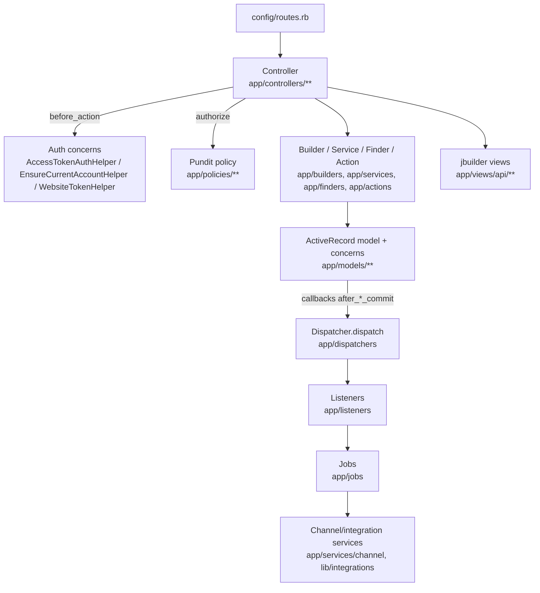

# Architecture Map

Commit `9f920b54`. Layer conventions and cross-cutting mechanisms.

## 1. Backend layers (VERIFIED by representative reading)

| Layer | Convention | Example |
|---|---|---|
| Controller | Thin; namespaced by API surface; `Current.*` set by concerns | `app/controllers/api/v1/accounts/conversations/messages_controller.rb:8-14` |
| Builder | Constructs aggregates, handles params/attachments | `Messages::MessageBuilder#perform` `app/builders/messages/message_builder.rb:24-33` |
| Service | PORO with `perform`, often `pattr_initialize [:x!]` (attr_extras gem) | `Base::SendOnChannelService` `app/services/base/send_on_channel_service.rb:10-19` |
| Finder | Filtering/pagination queries | `app/finders/conversation_finder.rb` |
| Model | Validations + **heavy callbacks** that trigger side effects | `Message#execute_after_create_commit_callbacks` `app/models/message.rb:324-333` |
| Concern | Shared model behavior | `AutoAssignmentHandler` `app/models/concerns/auto_assignment_handler.rb` |
| Listener | Singleton Wisper subscriber, method name == event name with `.`→`_` | `app/listeners/webhook_listener.rb` |
| Job | ActiveJob on Sidekiq queue | `SendReplyJob` (`:high`), `EventDispatcherJob` (`:critical`) |
| View | jbuilder partials | `app/views/api/v1/**` |

**Important consequence (INFERRED):** business side effects are triggered from **model callbacks**, not from controllers. Creating a `Message` by *any* path (API, widget, channel webhook job, automation, Captain) triggers the same fan-out. Bypassing callbacks (`update_column`, `insert_all`) bypasses events.

## 2. Request context: `Current` (VERIFIED `lib/current.rb:1-17`)

Thread-local `Current.user / account / account_user / executed_by / contact / inbox`. Set by:
- `ApplicationController#set_current_user` (`app/controllers/application_controller.rb:16-19`)
- `EnsureCurrentAccountHelper#current_account` (`app/controllers/concerns/ensure_current_account_helper.rb:4-7`)
- `AccessTokenAuthHelper#authenticate_access_token!` (`app/controllers/concerns/access_token_auth_helper.rb:14-21`)
- `WebsiteTokenHelper#set_contact` (`app/controllers/concerns/website_token_helper.rb:13-21`)

`Current.executed_by` is passed as `performed_by` in events (`app/models/message.rb:380`, `app/models/conversation.rb:389-393`) — used to suppress loops (e.g. `AutomationRuleListener#performed_by_automation?` line 96).

## 3. Event bus (VERIFIED) — see [flows/event-bus.md](flows/event-bus.md)

`Dispatcher.instance` holds `SyncDispatcher` (in-request) and `AsyncDispatcher` (via `EventDispatcherJob` on `:critical`). Wired in `config/initializers/event_handlers.rb`. Event names: `lib/events/types.rb`.

## 4. Enterprise overlay (VERIFIED) — see [modules/enterprise-overlay.md](modules/enterprise-overlay.md)

- `config/application.rb:42-50` adds `enterprise/app/**`, `enterprise/lib` to eager-load paths and prepends `enterprise/app/views`.
- `config/initializers/01_inject_enterprise_edition_module.rb` adds `prepend_mod_with / include_mod_with / extend_mod_with` to `Module`.
- `ChatwootApp.extensions` (`lib/chatwoot_app.rb:40-48`) returns `%w[enterprise]` if `enterprise/` exists and `DISABLE_ENTERPRISE` unset; `%w[enterprise custom]` if a `custom/` dir also exists.
- 109 injection points in OSS (`rg "(prepend|include|extend)_mod_with\(" app lib`).

## 5. Configuration layers (VERIFIED)

| Layer | Storage | Read via | Scope |
|---|---|---|---|
| ENV (`.env`) | process env | `ENV.fetch`, `config/app.yml` → `Chatwoot.config` | deployment |
| InstallationConfig | `installation_configs` table, seeded from `config/installation_config.yml` (112 entries) | `GlobalConfig.get_value` (Redis-cached 1 day, `lib/global_config.rb:40-55`), `GlobalConfigService.load` | installation |
| Account feature flags | bit columns `accounts.feature_flags`, `feature_flags_ext_1`; definitions `config/features.yml` (70 flags) | `Featurable` concern, `account.feature_enabled?` | account |
| Account settings | `accounts.settings` jsonb (JSON-schema validated, `AccountSettingsSchema`) | model accessors | account |
| Inbox config | inbox columns + channel tables (`provider_config`, etc.) | models | inbox |
| Frontend flags | `app/javascript/dashboard/featureFlags.js` | store getters | UI |

## 6. Frontend architecture (VERIFIED at structure level; PARTIAL detail)

- Multiple Vite entrypoints in `app/javascript/entrypoints/`: `dashboard.js`, `v3app.js` (auth), `widget.js`, `sdk.js`, `portal.js`, `survey.js`, `superadmin.js`, `superadmin_pages.js`.
- Dashboard: `createApp(App)` + vue-i18n + **Vuex** (`dashboard/store`, ~45 modules) + **Pinia** (`dashboard/stores`: calls, callHistory, companies) + vue-router (`dashboard/routes`) — `app/javascript/entrypoints/dashboard.js:43-51`.
- REST clients: `dashboard/api/*.js` extend `ApiClient` (`dashboard/api/ApiClient.js`) which builds `/api/v1[/accounts/:id]/<resource>` (or `/enterprise/api/v1/...` with `enterprise: true`).
- Realtime: `dashboard/helper/actionCable.js` (`ActionCableConnector`, event map at line ~40) consumes events broadcast by `ActionCableListener`.
- New UI components go in `dashboard/components-next/` (per `AGENTS.md`); legacy in `dashboard/components/`.
- Widget: separate Vue app `app/javascript/widget` (own store/router/api); host-page loader `app/javascript/sdk/IFrameHelper.js`.
