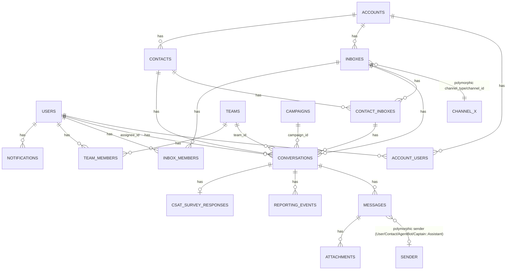

# Database Map

Commit `9f920b54`. Source of truth: `db/schema.rb` (schema version `2026_08_31_000000`, 98 tables) + `belongs_to`/`has_many` in `app/models/**`, `enterprise/app/models/**`.

## Critical facts (VERIFIED)

1. **Only 8 DB-level foreign keys** exist (`db/schema.rb:1599-1606`): ActiveStorage (2), `campaign_recipients` → accounts/campaigns/contacts/inboxes (4, `ON DELETE CASCADE`), `inboxes.portal_id` → portals, `user_sessions.user_id` → users. **All other relationships are enforced only by ActiveRecord.** Deletion cascades are done by `dependent: :destroy_async` (Sidekiq jobs), e.g. `app/models/account.rb:64-106`.
2. **Row-level multi-tenancy**: nearly every domain table has `account_id`; there is no Postgres RLS. Isolation depends on queries being scoped through `Current.account` / `account.<association>` (INFERRED from controller patterns).
3. **Per-account display IDs via triggers** (hairtrigger): `accounts` AFTER INSERT creates sequences `conv_dpid_seq_<id>` and `camp_dpid_seq_<id>`; `conversations`/`campaigns` BEFORE INSERT set `display_id := nextval(...)` (`db/schema.rb` tail; `app/models/conversation.rb:430`, `app/models/campaign.rb:164`). `Account#remove_account_sequences` on destroy (`app/models/account.rb:119`). Unique index `(account_id, display_id)` on conversations.
4. Extensions: `pg_trgm` (GIN trigram search on `contacts` name/email/phone/identifier and `messages.content`), `vector` (pgvector, Captain embeddings), `pgcrypto` (`conversations.uuid` default `gen_random_uuid()`).
5. Heavy **jsonb** usage for extensibility: `custom_attributes` (accounts, contacts, conversations, users), `additional_attributes` (contacts, conversations, messages, channel_api), `content_attributes` (messages — note: `json`, not `jsonb`), `settings`, `limits`, `internal_attributes`, `provider_config` (channels), `meta`.
6. Feature flags are **bitfields** in `accounts.feature_flags` / `feature_flags_ext_1` (bigint), position = order in `config/features.yml` (see [customization-surfaces.md](customization-surfaces.md)).

## Core ER diagram (VERIFIED associations)

## Table groups

| Domain | Tables | Owner model(s) |
|---|---|---|
| Tenancy & identity | `accounts`, `users`, `account_users`, `access_tokens` (polymorphic owner: User/AgentBot/PlatformApp), `user_sessions`, super admins are STI rows in `users` (`class SuperAdmin < User`, `app/models/super_admin.rb:47`) | `Account`, `User`, `AccountUser`, `AccessToken` |
| Channels | `inboxes` + `channel_api`, `channel_email`, `channel_facebook_pages`, `channel_instagram`, `channel_line`, `channel_sms`, `channel_telegram`, `channel_tiktok`, `channel_twilio_sms`, `channel_twitter_profiles`, `channel_web_widgets`, `channel_whatsapp` | `Inbox`, `Channel::*` |
| Conversations | `contacts`, `contact_inboxes`, `conversations`, `messages`, `attachments`, `conversation_participants`, `mentions`, `notes` | |
| Organization | `teams`, `team_members`, `inbox_members`, `labels`, `tags`, `taggings` (acts-as-taggable for labels), `custom_attribute_definitions`, `custom_filters`, `canned_responses`, `macros`, `working_hours`, `leaves` | |
| Automation | `automation_rules`, `automation_rule_pending_executions` (delayed automations), `agent_bots`, `agent_bot_inboxes`, `campaigns`, `campaign_recipients`, `assignment_policies`, `inbox_assignment_policies` | |
| Integrations | `integrations_hooks` (`app_id` string → `config/integration/apps.yml`), `webhooks`, `dashboard_apps`, `platform_apps`, `platform_app_permissibles` | |
| Help center | `portals`, `portals_members`, `categories`, `related_categories`, `folders`, `articles`, `article_embeddings` | |
| Reporting | `reporting_events`, `reporting_events_rollups`, `csat_survey_responses` | |
| Notifications | `notifications` (polymorphic primary/secondary actor), `notification_settings`, `notification_subscriptions` (web push/FCM) | |
| Config | `installation_configs` (name unique, jsonb `serialized_value`, `locked`) | `InstallationConfig` |
| Data import | `data_imports`, `data_import_items`, `data_import_errors`, `data_import_mappings` | |
| Email | `email_templates`, ActionMailbox `action_mailbox_inbound_emails` | |
| Storage | `active_storage_*` | |
| Audit (EE) | `audits` (audited gem) | `Enterprise::AuditLog` |
| SLA (EE) | `sla_policies`, `applied_slas`, `sla_events` | |
| RBAC (EE) | `custom_roles` (+ `account_users.custom_role_id`), `agent_capacity_policies`, `inbox_capacity_limits` | |
| SSO (EE) | `account_saml_settings` | |
| CRM (EE) | `companies` (+ `contacts.company_id`) | |
| Voice (EE) | `calls` | |
| Bookings (fork, #177) | `bookings` (AI agent booking requests; `ai_agents.booking_*` settings) | `Booking` |
| Captain AI (EE) | `captain_assistants`, `captain_inboxes`, `captain_documents`, `captain_assistant_responses`, `captain_scenarios`, `captain_custom_tools`, `captain_faq_suggestions`, `captain_faq_observations`, `captain_message_reports`, `agent_sessions`, `conversation_outcomes`, `copilot_threads`, `copilot_messages` | |

## Important uniqueness constraints (VERIFIED `db/schema.rb`)

- `account_users (account_id, user_id)` unique.
- `contacts (email, account_id)` unique; `(identifier, account_id)` unique; lower(email) index.
- `contact_inboxes (inbox_id, source_id)` unique; `pubsub_token` unique.
- `conversations (account_id, display_id)` unique; `uuid` unique.
- `labels (title, account_id)`, `teams (name, account_id)`, `webhooks (account_id, url)` unique.
- `channel_web_widgets.website_token`, `hmac_token` unique; `channel_api.identifier`, `hmac_token` unique.
- `installation_configs.name` unique.

## Data lifecycle & transactions

- Deletion: associations use `dependent: :destroy_async` (Rails' built-in `ActiveRecord::DestroyAssociationAsyncJob`); explicit large deletions use `DeleteObjectJob` (queue `:low`, batch 5,000, EE-prepended; called from e.g. `app/controllers/platform/api/v1/accounts_controller.rb:25`). Daily `Internal::DeleteAccountsJob` removes accounts marked for deletion.
- Housekeeping cron: stale contact inboxes, stale Redis keys, orphan conversations (every 12h), old notifications (>1 month / 300 per user) (`config/schedule.yml`).
- Explicit transactions are rare and local, e.g. `ReplyMailbox#process` (`app/mailboxes/reply_mailbox.rb:13`), message delete (`messages_controller.rb:23`). Most side effects run in `after_commit` callbacks **outside** the transaction (INFERRED best-effort consistency).

## Caching layers

- Redis `GlobalConfig` cache (1 day) for installation configs (`lib/global_config.rb`).
- Account cache keys / revalidation (`CacheKeys`, `AccountCacheRevalidator` concerns; `ACCOUNT_CACHE_INVALIDATED` event) for frontend IndexedDB/`CacheEnabledApiClient` (INFERRED from names).
- Denormalized columns: `conversations.cached_label_list`, `last_activity_at`, `waiting_since`, `first_reply_created_at`.
- Unread counts cache (`Conversations::UnreadCounts::*`, feature `conversation_unread_counts`).

## UNKNOWN

- Annotate comments at top of each model (annotaterb) mirror schema; not cross-checked for drift.
- Whether any query paths bypass `account_id` scoping (requires security review).
- `leaves` table exists in schema but no model referencing it was found (`rg leave app/models enterprise/app/models`) — purpose unknown.
