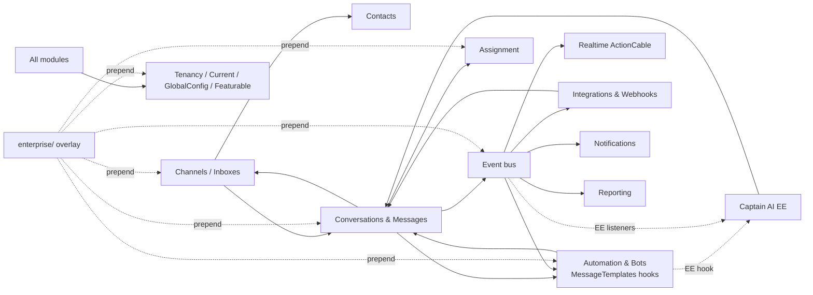

# Dependency & Relationship Map

Commit `9f920b54`. Built with ripgrep (no AST/call-graph tool available). Counts are **lower bounds**: they count files mentioning the constant by name, not association-based access like `message.conversation`.

## Module-level dependency graph (VERIFIED edges from code read; direction = "depends on")

**Cycle (VERIFIED, by design):** Conversations & Messages → (callbacks) Event bus → listeners (Automation, Captain, Bots) → create Messages / update Conversations → Event bus again. Loop guards: `performed_by` / `Current.executed_by` checks (e.g. `AutomationRuleListener#performed_by_automation?` `app/listeners/automation_rule_listener.rb:96`), `Base::SendOnChannelService#outgoing_message_originated_from_channel?` (`app/services/base/send_on_channel_service.rb:35-40`), `Message#prevent_message_flooding` (`app/models/message.rb:67`).

## Central components (fan-in, files referencing by name in app/ enterprise/ lib/)

| Component | Files | Notes |
|---|---|---|
| `Current` | 159 | thread-local request context; implicit dependency everywhere |
| `Account` | 113 | tenancy root |
| `Conversation` | 111 | 436-line model with 9 concerns and many callbacks |
| `User` | 88 | |
| `GlobalConfigService` | 66 | installation config reads (+ `GlobalConfig` 25) |
| `Message` | 60 | 463-line model; callbacks drive outbound + all events |
| `Redis::Alfred` | 54 | Redis helper (presence, round robin, locks, unread counts) |
| `ChatwootExceptionTracker` | 53 | error reporting wrapper |
| `ChatwootApp` | 49 | edition/env checks (`enterprise?`, `chatwoot_cloud?`) |
| `Contact` | 47 | |
| `InstallationConfig` | 46 | |
| `Inbox` | 42 | |
| `Rails.configuration.dispatcher` | 25 | event emission sites |

## Key relationship types

| Relationship | Pattern | Example evidence |
|---|---|---|
| Controller → Builder/Service | direct instantiation `X.new(...).perform` | `messages_controller.rb:10` → `Messages::MessageBuilder` |
| Model → Event | `Rails.configuration.dispatcher.dispatch(EVENT, time, data)` in `after_*_commit` | `message.rb:380`, `conversation.rb:389-393`, `inbox.rb:86-87`, `contact.rb:66-68` |
| Event → Listener | Wisper, method name from event | `lib/events/base.rb:11-13` |
| Listener → Job | `perform_later` | `webhook_listener.rb:116`, `hook_listener.rb:46`, `action_cable_listener.rb:230` |
| Model → Job (direct) | callbacks enqueue jobs | `message.rb:401` `SendReplyJob`; `auto_assignment_handler.rb:33` |
| Job → Channel service | lookup table | `send_reply_job.rb:4-16` |
| Job → External API | provider SDK / HTTP | `lib/webhooks/trigger.rb`, `app/services/whatsapp/providers/*`, `twilio-ruby`, `koala`, `line-bot-api`, `slack-ruby-client` |
| OSS → EE | `X.prepend_mod_with('X')` at file bottom | 109 sites; [enterprise-overlay](modules/enterprise-overlay.md) |
| Frontend → Backend | REST via `ApiClient`, websockets via `ActionCableConnector` | `dashboard/api/ApiClient.js`, `dashboard/helper/actionCable.js` |

## Queues (VERIFIED `config/sidekiq.yml`, strict priority order)

critical (EventDispatcherJob, ActionCableBroadcastJob) → high (SendReplyJob) → medium (WebhookJob, HookJob) → default → mailers → action_mailbox_routing → low (DeleteObjectJob) → scheduled_jobs (cron) → deferred → purgable → housekeeping → async_database_migration → bulk_reindex_low → active_storage_analysis → active_storage_purge → action_mailbox_incineration.

Because queues are strictly ordered (no weights), a flood in a higher queue starves lower ones (comment in `config/sidekiq.yml`).

## External systems

| System | Used by | Config |
|---|---|---|
| PostgreSQL | everything | `config/database.yml` |
| Redis | cache, ActionCable, Sidekiq, `$alfred`, `$velma` (rack-attack) | `REDIS_URL`, `config/cable.yml`, `config/initializers/01_redis.rb` |
| Meta (WhatsApp Cloud, Messenger, Instagram), Twilio, Telegram, LINE, TikTok, Twitter, Bandwidth SMS (INFERRED for `Channel::Sms`) | channel services | per-channel `provider_config` / InstallationConfig app secrets |
| SMTP / SES / IMAP / Microsoft Graph / Gmail OAuth | email | ENV + channel_email |
| Object storage (S3 / Azure / GCS) | ActiveStorage | `config/storage.yml` |
| OpenAI / Anthropic / Gemini (via ruby_llm) | Captain, AI helpers | `config/llm.yml`, InstallationConfig |
| OpenSearch | advanced search (EE) | `OPENSEARCH_URL` |
| Stripe | billing (EE, cloud) | `config/initializers/stripe.rb` |
| Chatwoot Hub (`ChatwootHub.sync_with_hub`) | version check, plan info, push relay | `lib/chatwoot_hub.rb`; daily job, **production only** (`app/jobs/internal/check_new_versions_job.rb:5`) |
| Firecrawl, Notion, Linear, Shopify, Slack, Dialogflow, Google Translate, Dyte, LeadSquared, Clearbit | integrations | `config/integration/apps.yml` |
| MaxMind GeoIP | IP lookup | `rails ip_lookup:setup` in Procfile |
| FCM / Web Push (VAPID) | mobile/browser push | `lib/vapid_service.rb`, `app/services/notification/fcm_service.rb` |

## Requires runtime verification

- Exact listener execution order inside each dispatcher (Wisper subscribe order = array order, INFERRED).
- Which provider services are actually exercised depends on configured inboxes.
- ActiveJob serialization of AR objects in async events.
