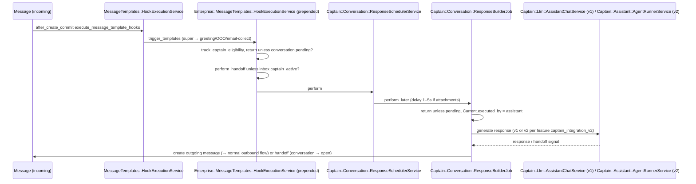

# Flow: Captain AI Auto-Response (Enterprise)

Commit `9f920b54`. Status: **VERIFIED** for trigger chain and job entry; LLM/tool internals only located.
Requires `enterprise/` present; licensed separately (`enterprise/LICENSE`).

## Evidence

| Step | Location |
|---|---|
| Hook entry | `app/models/message.rb:441-443` |
| EE override | `enterprise/app/services/enterprise/message_templates/hook_execution_service.rb:2-16` |
| Captain active = assistant attached via `captain_inboxes` and more responses allowed (usage limit) | `enterprise/app/models/enterprise/inbox.rb:15-17`; `enterprise/app/models/enterprise/concerns/inbox.rb:5-8` |
| Scheduler & attachment wait | `enterprise/app/services/captain/conversation/response_scheduler_service.rb:1-40` |
| Job, v1/v2 branch, error handoff | `enterprise/app/jobs/captain/conversation/response_builder_job.rb:12-34` and private methods 40-223 |
| Conversation starts `pending` when a bot is active | `app/models/conversation.rb:312-325` |
| Post-resolution memory/FAQ | `enterprise/app/listeners/captain_listener.rb:12-23` |

## Related Captain components (located)

- Models: `enterprise/app/models/captain/{assistant,document,scenario,custom_tool,assistant_response,agent_session,faq_*,message_report}.rb`; tables `captain_*`, `article_embeddings` (pgvector).
- Services: `enterprise/app/services/captain/{llm,tools,assistant,copilot,documents,playground,conversation}`.
- Prompts/schemas: `enterprise/lib/captain/{prompts,*_schema.rb,prompt_renderer.rb}`.
- OSS AI helpers (reply suggestion, summary, rewrite, labels): `lib/captain/*.rb` (some EE-prepended).
- LLM provider/model registry: `config/llm.yml`, `lib/llm/{config,models,feature_router}.rb`.
- Copilot (agent-assist chat): `CopilotThread`, `CopilotMessage`, event `COPILOT_MESSAGE_CREATED` → `Enterprise::ActionCableListener`.

## Unknowns

- Exact tool-calling loop in `AgentRunnerService` and usage/credit accounting not traced.
- `more_responses?` limit source (billing / plan) not traced.
