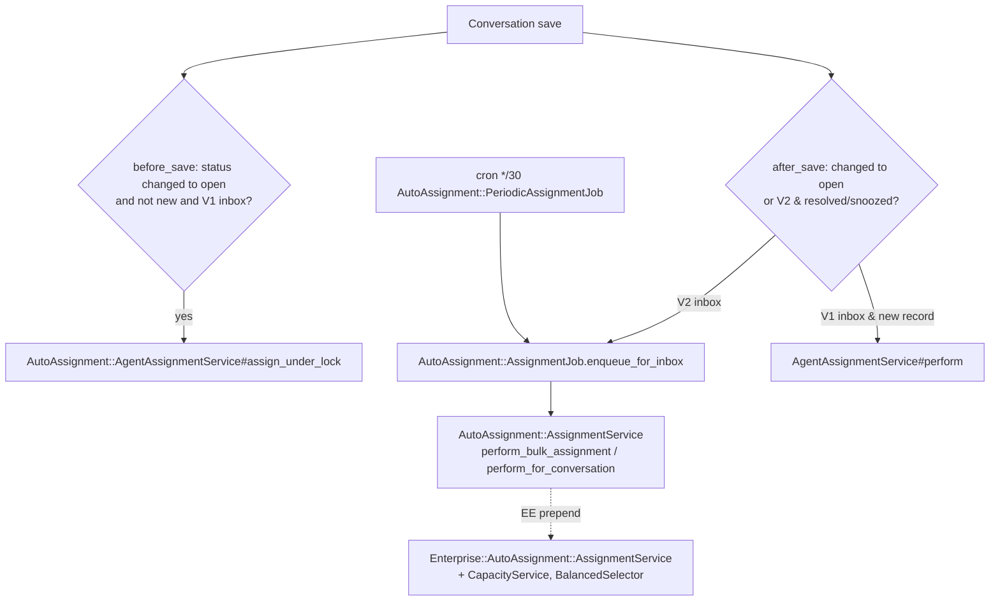

# Flow: Conversation Status & Auto-Assignment

Commit `9f920b54`. Status: **VERIFIED** for triggers and entry services; selector internals not read.

## Conversation creation status (VERIFIED `app/models/conversation.rb`)

- `before_create :determine_conversation_status` (line 138). If the inbox has an active bot (`inbox.active_bot?` → agent bot inbox active or Dialogflow; EE extends for Captain), the conversation starts **`pending`** and `ai_assignee` may be set to the agent bot (lines 312-325).
- Status enum: `open 0, resolved 1, pending 2, snoozed 3` (line 86). Priority enum `low..urgent` (line 87).
- Fork (#204): `before_save :hand_pending_conversation_to_ai_agent` (updates only). An existing conversation that moves to `pending` in an inbox with an AI agent gets `ai_assignee = inbox.ai_agent` and loses its human `assignee`, on every path (toggle, bulk, automation, contact reopening a resolved conversation). See [modules/ai-agent.md](../modules/ai-agent.md#conversation-control-204).
- `display_id` is assigned by a **Postgres trigger** from per-account sequence `conv_dpid_seq_<account_id>` (line 430; `db/schema.rb` triggers). `load_attributes_created_by_db_triggers` re-reads it after create (line 143, 373).

## Update callbacks → events (VERIFIED lines 141, 268-274, 337-393)

`after_update_commit :execute_after_update_commit_callbacks` →
1. `handle_resolved_status_change` (clears `waiting_since` via `update_column`)
2. `notify_status_change` → `CONVERSATION_OPENED / RESOLVED / STATUS_CHANGED / READ / CONTACT_CHANGED`
3. `create_activity` (activity messages via `ActivityMessageHandler`, EE-prepended)
4. `invalidate_filtered_unread_count_conversation`
5. `notify_conversation_updation` → `CONVERSATION_UPDATED` only if a key in `list_of_keys` changed (team, assignee, status, snooze, custom_attributes, labels, waiting_since, priority, …)

Assignee/team change events (`ASSIGNEE_CHANGED`, `TEAM_CHANGED`) come from `AssignmentHandler` concern (`app/models/concerns/assignment_handler.rb`, not read in detail).

## Auto-assignment (VERIFIED `app/models/concerns/auto_assignment_handler.rb`)

- V1 vs V2 switch: `inbox.auto_assignment_v2_enabled?` (lines 17, 29). Account feature `assignment_v2` / `advanced_assignment` in `config/features.yml` (INFERRED link).
- V1 candidate pool: team members with capacity if team set, else inbox members (`legacy_allowed_agent_ids`, lines 41-54).
- V2 services: `app/services/auto_assignment/{assignment_service,round_robin_selector,rate_limiter,inbox_round_robin_service}.rb`; EE `enterprise/app/services/enterprise/auto_assignment/{assignment_service,balanced_selector,capacity_service}.rb`.
- Round-robin state lives in Redis (`$alfred` comment "Used for Round Robin", `config/initializers/01_redis.rb`).
- Policy tables: `assignment_policies`, `inbox_assignment_policies`, EE `agent_capacity_policies`, `inbox_capacity_limits`.

## Auto-resolve

`Account::ConversationsResolutionSchedulerJob` (EE-prepended) and `accounts.settings.auto_resolve_after` (`Account.with_auto_resolve` scope, `app/models/account.rb:113`); scheduled via `TriggerScheduledItemsJob` (every 5 min). Snoozed conversations are reopened by scheduled items (INFERRED).
