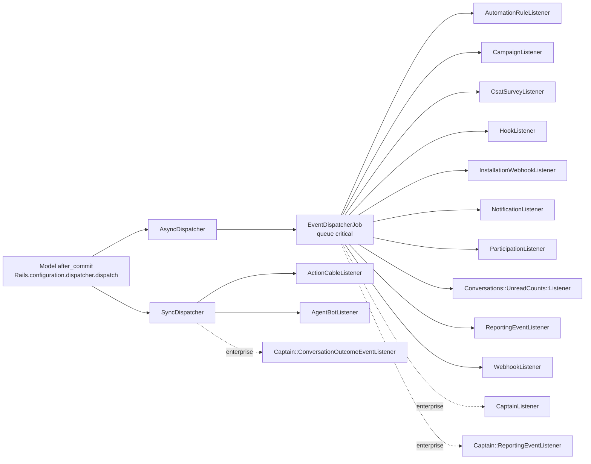

# Flow: Domain Event Bus (Dispatcher → Listeners)

Commit `9f920b54`. Status: **VERIFIED** (wiring and listener lists read in source).

## Wiring

| Step | Evidence |
|---|---|
| Boot: `Rails.configuration.dispatcher = Dispatcher.instance; load_listeners` | `config/initializers/event_handlers.rb:1-6` |
| `Dispatcher#dispatch` calls **both** sync and async dispatchers; the `async` argument is ignored | `app/dispatchers/dispatcher.rb:15-18` |
| `SyncDispatcher` publishes in-process immediately | `app/dispatchers/sync_dispatcher.rb:2-5` |
| `AsyncDispatcher#dispatch` enqueues `EventDispatcherJob` (queue `:critical`) which calls `publish_event` in Sidekiq | `app/dispatchers/async_dispatcher.rb:2-9`, `app/jobs/event_dispatcher_job.rb:1-7` |
| Event object; Wisper method name = event name with `.` → `_` (e.g. `message.created` → `message_created`) | `lib/events/base.rb` (INFERRED from listener method names matching `lib/events/types.rb`) |
| Event constants | `lib/events/types.rb` |

## Listener registry

Sources: `app/dispatchers/sync_dispatcher.rb:7-9`, `app/dispatchers/async_dispatcher.rb:11-24`, `enterprise/app/dispatchers/enterprise/{sync,async}_dispatcher.rb`.

## What each listener does (VERIFIED handler names; downstream calls)

| Listener | Handles | Side effect |
|---|---|---|
| `ActionCableListener` (sync) | message/conversation/contact/notification/typing/presence events | `ActionCableBroadcastJob.perform_later(tokens, event, payload)` → websocket (`app/listeners/action_cable_listener.rb:221-231`) |
| `AgentBotListener` (sync) | conversation_*, message_created/updated, webwidget_triggered | `AgentBots::WebhookJob` to bot `outgoing_url` (`app/listeners/agent_bot_listener.rb:84-87`) |
| `AutomationRuleListener` | conversation_created/updated/opened/resolved, message_created | `AutomationRules::ConditionsFilterService` → `AutomationRules::ActionService` (`app/listeners/automation_rule_listener.rb:31,53,78`) |
| `CampaignListener` | campaign_triggered, message_updated | `Campaigns::CampaignConversationBuilder`; for a message with `additional_attributes.campaign_recipient_id` (written only by `Whatsapp::OneoffCampaignService`; clients can set `campaign_id` through `MessageBuilder` but not this key), `CampaignRecipient#sync_with_message!` moves the recipient of the message's account and contact forward (queued → sent → delivered → read, or failed) from the message's `source_id`/`status` (#160) |
| `CsatSurveyListener` | conversation_status_changed, message_updated | `CsatSurveyService`, `CsatSurveys::ResponseBuilder` |
| `HookListener` | message/contact/conversation events | `HookJob` → slack / dialogflow / google_translate / leadsquared / linear (`app/jobs/hook_job.rb:6-12`) |
| `InstallationWebhookListener` | account_created | `WebhookJob` to installation-level webhook |
| `NotificationListener` | conversation_created, assignee_changed, bot_handoff, message_created | `NotificationBuilder`, `Messages::MentionService`, `Messages::NewMessageNotificationService` |
| `ParticipationListener` | assignee_changed | adds conversation participants (INFERRED) |
| `Conversations::UnreadCounts::Listener` | unread-count related events | maintains cached unread counts (INFERRED from name; not read) |
| `ReportingEventListener` | conversation_resolved/opened, first_reply_created, reply_created, bot_handoff | creates `ReportingEvent` rows + `ReportingEvents::RollupService` |
| `WebhookListener` | conversation/message/contact/inbox/typing events | `WebhookJob` to account webhooks (if `api_and_webhooks` enabled) and to API-channel `webhook_url` (`app/listeners/webhook_listener.rb:110-131`) |
| `CaptainListener` (EE) | message_updated (CSAT), conversation_resolved | Captain outcome tracking, contact notes, FAQ generation |

## Gotchas (VERIFIED / INFERRED)

- Async event payloads contain ActiveRecord objects (e.g. `message: self`) serialized through ActiveJob/GlobalID. If the record is deleted before the job runs, deserialization fails. (INFERRED — standard ActiveJob behavior, not runtime-tested.)
- Sync listeners run inside the request/job that saved the model (after commit) — slow sync listeners slow the request.
- Adding an event: add constant to `lib/events/types.rb`, dispatch from model/service, add method to listener(s); for webhook delivery also add to `Webhook` subscriptions allow-list (`webhooks.subscriptions` default in `db/schema.rb`; model validation in `app/models/webhook.rb` — not read in detail).
