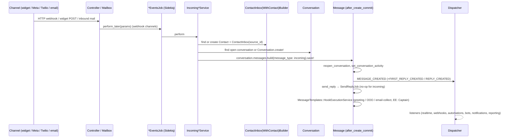

# Flow: Inbound Customer Message (channel → conversation → fan-out)

Commit `9f920b54`. Status: **VERIFIED** for widget, WhatsApp, email entry points and the shared model-callback tail; other channels **INFERRED** to follow the same shape.

## Shared shape

## Entry points by channel

| Channel | Entry | Async hop | Processing | Evidence |
|---|---|---|---|---|
| Web widget | `POST /api/v1/widget/messages` → `Api::V1::Widget::MessagesController#create` | none (in-request) | `conversation.messages.new(message_params).save!`; creates conversation if none (`set_conversation`) | `app/controllers/api/v1/widget/messages_controller.rb:10-14,55-60`; `message_params` sets `message_type: :incoming`, `sender: @contact` (`app/controllers/api/v1/widget/base_controller.rb:79-91`) |
| WhatsApp (Cloud/360dialog) | `POST /webhooks/whatsapp/:phone_number` → `Webhooks::WhatsappController#process_payload` (Meta signature verified) | `Webhooks::WhatsappEventsJob` (per-sender lock) | `Whatsapp::IncomingMessageService` < `IncomingMessageBaseService`: `set_contact`, `set_conversation`, `create_message` | `app/controllers/webhooks/whatsapp_controller.rb:4-16`; `app/jobs/webhooks/whatsapp_events_job.rb:8-35`; `app/services/whatsapp/incoming_message_base_service.rb:100-176` |
| Twilio SMS/WhatsApp | `POST /twilio/callback` → `Twilio::CallbackController#create` | `Webhooks::TwilioEventsJob` | `Twilio::IncomingMessageService` (INFERRED name from dir listing) | `app/controllers/twilio/callback_controller.rb:2-6` |
| Email | ActionMailbox ingress → `ApplicationMailbox` routing → `ReplyMailbox` (or `DefaultMailbox`) | ActionMailbox routing job | `Mailbox::ConversationFinder` → transaction: persist conversation, create message, attachments | `app/mailboxes/application_mailbox.rb:10-18`; `app/mailboxes/reply_mailbox.rb:6-34` |
| Email (IMAP) | cron `Inboxes::FetchImapEmailInboxesJob` every minute | Sidekiq | `app/services/imap/*`, `app/mailboxes/imap/*` (not traced) | `config/schedule.yml` |
| Facebook / Instagram | `mount Facebook::Messenger::Server, at: 'bot'`; `POST /webhooks/instagram` | jobs under `app/jobs/webhooks/` | `app/services/facebook/*`, `app/services/instagram/*` (not traced) | `config/routes.rb:671,680` |
| Telegram / LINE / SMS / TikTok / Shopify | `POST /webhooks/{telegram/:bot_token, line/:line_channel_id, sms/:phone_number, tiktok, shopify}` | jobs under `app/jobs/webhooks/` | `app/services/<channel>/*` (not traced) | `config/routes.rb:674-682` |
| API channel | `POST /api/v1/accounts/:id/conversations/:cid/messages` with `message_type: incoming` | none | `Messages::MessageBuilder` | `app/builders/messages/message_builder.rb:14,24-33` |

## Contact resolution (VERIFIED)

`ContactInboxWithContactBuilder#perform` (`app/builders/contact_inbox_with_contact_builder.rb:8-45`) finds a contact by identifier / email / phone (and Instagram source_id), else `account.contacts.create!`, then `ContactInboxBuilder` creates the `contact_inboxes` row (unique on `inbox_id, source_id`, `db/schema.rb` `contact_inboxes` indexes). Race-condition retry is built in (comment at line 10-13).

## Message-side tail (VERIFIED `app/models/message.rb`)

`after_create_commit :execute_after_create_commit_callbacks` (line 138) runs, in order (lines 324-333):
1. `reopen_conversation` — snoozed → open; resolved → reopen (unless muted) (404-411)
2. `mark_pending_conversation_as_open_for_human_response` (413+)
3. `set_conversation_activity` — `update_columns(last_activity_at)` (449-453, **skips callbacks**)
4. `dispatch_create_events` — `MESSAGE_CREATED`; `FIRST_REPLY_CREATED` or waiting_since bookkeeping / `REPLY_CREATED` (379-388, 340-356)
5. `send_reply` — `SendReplyJob` (2s delay if attachments) (398-402)
6. `execute_message_template_hooks` — `MessageTemplates::HookExecutionService` (441-443)
7. `update_contact_activity` (336-338)

Also `after_commit :reindex_for_search` (line 141) when Searchkick is active.

## Error handling

- Widget: `prevent_reply_to_resolved_conversation` before_action; `save!` raises → `RequestExceptionHandler` (`app/controllers/concerns/request_exception_handler.rb`).
- WhatsApp: inactive number → 422 (`whatsapp_controller.rb:7-11`); signature failure handled by `MetaTokenVerifyConcern`; per-sender lock with retry budget (`whatsapp_events_job.rb:3`).
- Email: no conversation → message dropped with log (`reply_mailbox.rb:8,26`); transaction prevents orphan conversations.

## Missing links (UNKNOWN)

Per-channel incoming services for Facebook, Instagram, Telegram, LINE, TikTok, SMS, Twitter were not read; assumed to follow builder → conversation → message shape.
