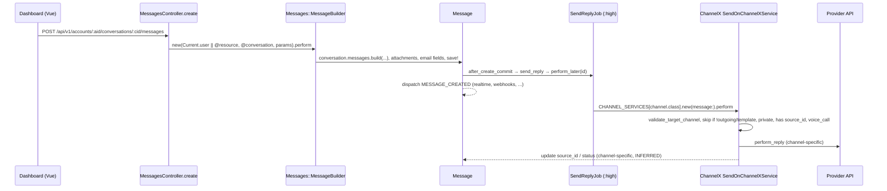

# Flow: Agent / Bot Reply → External Channel

Commit `9f920b54`. Status: **VERIFIED** to the channel-service boundary; provider HTTP calls not traced.

## Evidence

| Step | Location |
|---|---|
| Controller create | `app/controllers/api/v1/accounts/conversations/messages_controller.rb:8-14` |
| Builder defaults `message_type` to `outgoing`, handles attachments, private, in_reply_to | `app/builders/messages/message_builder.rb:8-33` |
| Callback → job | `app/models/message.rb:398-402` |
| Channel routing table | `app/jobs/send_reply_job.rb:4-28` (FacebookPage special-cased: Instagram DM vs Messenger at 32-38) |
| Base guard logic (template method) | `app/services/base/send_on_channel_service.rb:13-55` |
| Web widget & API channels | mapped to `Messages::SendEmailNotificationService`: if the contact has an email and email reply is enabled, it sets a Redis NX key and enqueues `ConversationReplyEmailJob` with a 2-minute delay (batched transcript email, rate-limited per account) (`app/services/messages/send_email_notification_service.rb:4-25`) — delivery to widget itself is realtime via ActionCable; delivery to API channel is via `WebhookListener` → `channel.webhook_url` (`app/listeners/webhook_listener.rb:122-128`) |
| Retry | `MessagesController#retry` re-enqueues `SendReplyJob` (`messages_controller.rb:28-33`) |
| Delivery status | channel webhooks → `Messages::StatusUpdateService` (e.g. `whatsapp/incoming_message_base_service.rb:61-67`) |

## Loop prevention (VERIFIED)

`invalid_message?` returns true when `message.source_id.present?` — messages that originated from the channel (echoes) are not re-sent (`send_on_channel_service.rb:35-51`).

## Adding a new channel (INFERRED checklist)

1. `app/models/channel/<name>.rb` including `Channelable`; table `channel_<name>`; `has_many` on `Account`.
2. Inbound webhook route + controller + `Webhooks::<Name>EventsJob` + `<Name>::IncomingMessageService`.
3. `<Name>::SendOn<Name>Service < Base::SendOnChannelService`; register in `SendReplyJob::CHANNEL_SERVICES`.
4. Frontend inbox creation UI under `dashboard/routes/dashboard/settings/inbox/` and API client in `dashboard/api/channel/`.
5. Consider `ContactInbox#valid_source_id_format?` (`app/models/contact_inbox.rb:76-77`) and `Inbox` channel-type helpers.
