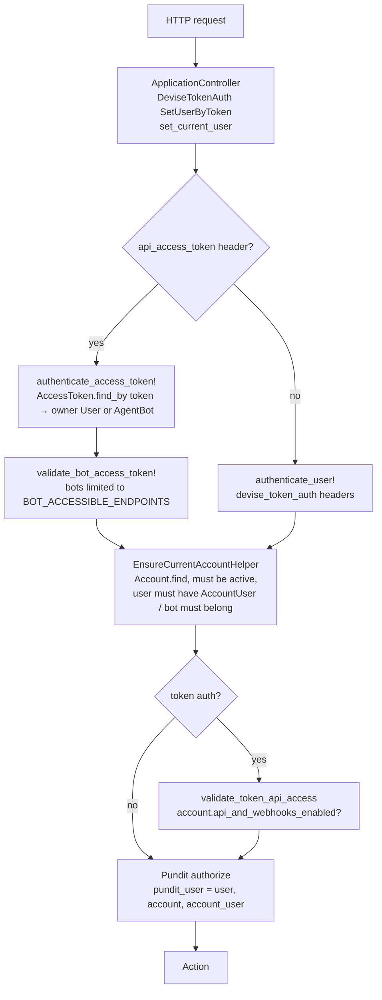

# Flow: Request Authentication, Tenancy & Authorization

Commit `9f920b54`. Status: **VERIFIED** for dashboard/API, widget, platform. SAML/OAuth paths only located, not traced; MFA token rejection traced for #135.

## Account-scoped API (`/api/v1/accounts/:account_id/...`)

| Step | Evidence |
|---|---|
| Token-header session auth, Pundit, `skip_before_action :verify_authenticity_token` | `app/controllers/application_controller.rb:1-28` |
| API vs user auth switch | `app/controllers/api/base_controller.rb:4-12` |
| Access token & bot allow-list | `app/controllers/concerns/access_token_auth_helper.rb:2-39` |
| Tenancy check | `app/controllers/concerns/ensure_current_account_helper.rb:9-34` |
| API feature gate for tokens | `app/controllers/api/v1/accounts/base_controller.rb:10-14` |
| Policy example (admin, bot, or inbox/team membership) | `app/policies/conversation_policy.rb:10-36` |
| Enterprise custom roles override `permissions` | `enterprise/app/models/enterprise/account_user.rb:2-3` + `enterprise/app/policies/enterprise/*` |

Roles: `AccountUser.role` enum `agent: 0, administrator: 1` (`app/models/account_user.rb:34`); EE adds `custom_role_id`.

## Widget (`/api/v1/widget/...`)

`Api::V1::Widget::BaseController` → `WebsiteTokenHelper`: `website_token` param → `Channel::WebWidget` → account (must be active); `X-Auth-Token` header decoded by `Widget::TokenService` → `source_id` → `ContactInbox` → `Current.contact` (`app/controllers/concerns/website_token_helper.rb:1-25`). HMAC-verified contact inboxes can see conversations across verified inboxes (`app/controllers/api/v1/widget/base_controller.rb:10-17`).

## Platform API (`/platform/api/v1/...`)

`PlatformController`: access token owner must be a `PlatformApp`; per-resource `platform_app_permissibles` check (`app/controllers/platform_controller.rb:4-35`).

## Realtime

`RoomChannel#subscribed`: `pubsub_token` (+`user_id` for agents) → User or Contact (via ContactInbox); agents also stream `account_<id>` (`app/channels/room_channel.rb:1-48`).

## Other auth paths (located, not traced)

- devise_token_auth mount: `config/routes.rb:3`; overrides `app/controllers/devise_overrides/*` (EE-prepended).
- SAML: `POST /api/v1/auth/saml_login` (`config/routes.rb:472`), `AccountSamlSettings` (EE).
- OmniAuth (Google etc.): `config/initializers/omniauth.rb`.
- MFA: `devise-two-factor`; only enabled when AR encryption keys set (`config/application.rb` `Chatwoot.mfa_enabled?`). Profile MFA management (`/api/v1/profile/mfa*`) requires a devise_token_auth session: `api_access_token` requests get `403` before any other check (`Api::V1::Profile::MfaController#ensure_interactive_session`, issue #135). Note that `set_current_user` runs before `authenticate_access_token!`, so `@user` is nil for token requests unless a controller sets it again (as `ProfilesController#set_user` does). MFA request specs only run with `ACTIVE_RECORD_ENCRYPTION_*` set, which fork CI does not do.
- Super Admin: `devise_for :super_admins` (`config/routes.rb:725`).
- Rate limiting: `config/initializers/rack_attack.rb` (Redis `$velma`).
