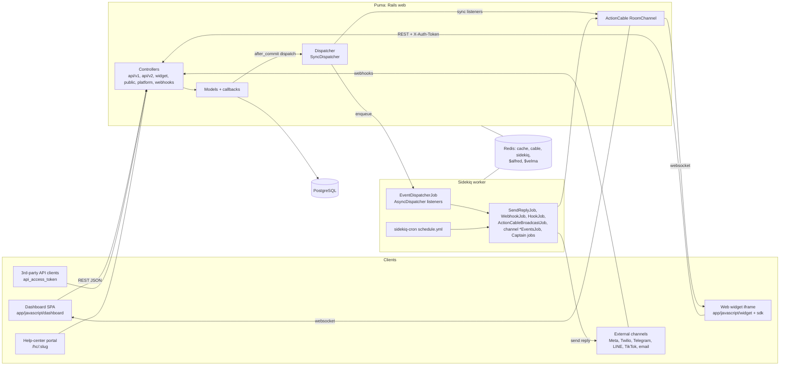

# System Overview

Commit `9f920b54`.

## One-paragraph summary (VERIFIED)

An omnichannel customer-support platform. **Channels** (web widget, email, WhatsApp, Facebook, Instagram, TikTok, Telegram, LINE, Twilio SMS, generic SMS, Twitter, API) feed **incoming messages** into multi-tenant **Accounts**. Each channel is wrapped by an **Inbox**; a customer is a **Contact** linked to an inbox via **ContactInbox**; messages live in **Conversations**. Agents (Users) reply from a Vue dashboard; replies are pushed back to the originating channel by background jobs. Every significant model change emits an **event** on an in-process bus (Wisper) that fans out to realtime (ActionCable), webhooks, notifications, automations, agent bots, integrations, reporting and (enterprise) the **Captain** AI agent.

## Runtime diagram

## Architectural classification (VERIFIED unless noted)

| Pattern | Evidence |
|---|---|
| **Modular monolith** (single Rails app, single DB) | One `config/application.rb`, one `db/schema.rb`; no service boundaries |
| **Layered MVC + service objects** | Controllers → Builders/Services (`pattr_initialize` POROs) → Models; jbuilder views |
| **Event-driven internals** | `Rails.configuration.dispatcher` (Wisper) with sync + async listeners (`app/dispatchers/*`) |
| **Multi-tenant by row** (`account_id` on nearly every table) | `db/schema.rb`; `EnsureCurrentAccountHelper` scoping |
| **Open-core overlay** | `enterprise/` modules prepended into OSS classes (`config/initializers/01_inject_enterprise_edition_module.rb`) |
| **Polymorphic channel adapter** | `Inbox belongs_to :channel, polymorphic: true` (`app/models/inbox.rb:62`); per-channel `SendOn*Service` (`app/jobs/send_reply_job.rb:4-16`) |
| Not hexagonal / not microservices | No ports/adapters layer; models call services and vice-versa (INFERRED from callback code) |

## Main application surfaces

| Surface | Mount | Auth | Frontend |
|---|---|---|---|
| Agent dashboard | `/app/*` → `DashboardController#index` | devise_token_auth headers | `entrypoints/dashboard.js` |
| Auth pages (login/signup/reset) | `/app/login` etc. | — | `entrypoints/v3app.js` (`app/javascript/v3`) |
| Account API | `/api/v1/accounts/:account_id/*` | user token or `api_access_token` | — |
| Widget API | `/api/v1/widget/*` | `website_token` + `X-Auth-Token` JWT | `entrypoints/widget.js`, `entrypoints/sdk.js` |
| Public client API | `/public/api/v1/inboxes/*` | inbox identifier | — |
| Platform API | `/platform/api/v1/*` | PlatformApp access token + permissibles | — |
| Help center | `/hc/:slug/*` | public | `entrypoints/portal.js` |
| Super Admin | `/super_admin/*` (+ `/monitoring/sidekiq`) | devise `SuperAdmin` | administrate + `superadmin.js` |
| Channel webhooks | `/webhooks/*`, `/bot`, `/twilio/*` | per-provider signatures | — |
| Enterprise API | `/enterprise/api/v1/*`, Stripe/Firecrawl webhooks | as above | — |

See [api-map.md](api-map.md) for detail.
